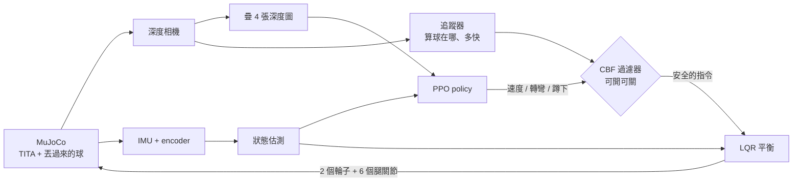
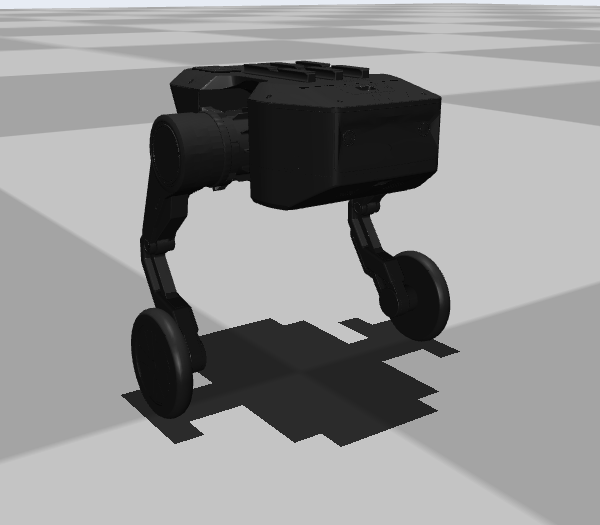

# Mini PAC-MAN

## Pipeline

每 0.02 秒跑一次這個流程：



PPO 決定要開多快、要不要轉彎、要不要蹲，CBF 在快撞到的時候把指令改掉一點點，LQR 負責不要倒。

## 實驗

| 實驗 | 想知道什麼 | 比什麼 | 組數 |
|---|---|---|---|
| 實驗 1 | 安全要在訓練的時候教，還是跑的時候直接擋？ | 3 種 reward（只管到終點 / 被打到扣分 / 加 CBF 項）× 過濾器 關、開 | 6 |
| 實驗 2 | TITA 加速要 0.36 秒，過濾器沒算到這個延遲會不會出事？ | 簡單版、考慮延遲版 × 每一步重算、只決定一次，再加一組不開過濾器 | 5 |
| 實驗 3 | 球的位置不準的時候，過濾器還有沒有用？ | 球的資訊用 真實值 / 加雜訊跟延遲 / 深度相機估的，再加一組不開過濾器 | 4 |

每組都跑同一批 100 個 seed，看有沒有到終點、被打到幾顆、離球最近多近、過濾器出手多少。
全部要在 AMD 的機器上跑（課程規定，CUDA 跑的不算）。

## 機器人：TITA



Direct Drive Technology（DDT）的 TITA，兩隻腳加兩個輪子，8 個關節，25.7 kg。

模型來源：[DDTRobot/ddt_ros2_control](https://github.com/DDTRobot/ddt_ros2_control) 裡的 `urdfs/tita_description`（commit `beb05df`），上面那張是我們用 MuJoCo 畫的。
這個模型沒有寫授權，所以沒有放進 repo，要自己跑 `python scripts/download_tita.py` 下載。

## 檔案在幹嘛

```
mini-pacman/
├── train_mini_pacman_policy.py     訓練 PPO，--reward 選哪種 reward
├── run_mini_pacman_experiments.py  跑實驗，--part 選跑哪個；要用哪個 policy 改最上面的 POLICY_FILES
├── minipacman/
│   ├── config.py           所有參數都在這，要改數字就改這裡
│   ├── scene.py            做 MuJoCo 場景（TITA + 地板 + 5 顆球）
│   ├── env.py              TITA 本體：載模型、擺姿勢、讀狀態
│   ├── lqr.py              LQR 平衡，把指令變成馬達指令
│   ├── sensors.py          IMU、encoder（會加雜訊）
│   ├── state_estimator.py  用 IMU + encoder 猜機器人現在的狀態
│   ├── balls.py            丟球、彈跳、預測球會飛去哪、有沒有被打到
│   ├── depth_camera.py     深度相機
│   ├── ball_tracker.py     從深度圖找球、追球
│   ├── ball_sources.py     球的資訊從哪來（真實值 / 加雜訊 / 深度相機）
│   ├── cbf.py              CBF 的 reward 項跟安全過濾器
│   ├── dodge_env.py        RL 環境，把上面全部接起來
│   ├── vec_env.py          一次跑很多個環境，接 rsl_rl
│   ├── train_ppo.py        PPO 的設定
│   ├── evaluate.py         用固定 seed 跑一組實驗
│   ├── report.py           算數字、畫圖
│   └── runtime.py          記錄用哪張 GPU、是不是 ROCm
├── scripts/
│   └── download_tita.py    下載 TITA 模型
├── tests/                  測試，寫完一個模組就把那個測試檔的 skip 拿掉
├── docs/                   README 用的圖
├── third_party/            下載的 TITA 放這（不會進 git）
└── outputs/                訓練跟實驗的結果（不會進 git）
```

想知道哪些寫好了、哪些還沒：`python run_mini_pacman_experiments.py --part check`

## 協作：push / pull 不要打架

幾個規則：

1. 不要直接在 main 上改，每個人開自己的 branch。
2. 盡量只改自己負責的檔案。`config.py` 大家都會動，要改之前在群組講一聲。
3. push 之前先把 main 最新的拉進來，再跑一次 `pytest`，沒壞再 push。
4. `third_party/`、`outputs/` 不會進 git，訓練出來的 `.pt` 也不要硬加進去（太大）。
5. 用 PR 合併，至少讓另一個人看過再 merge。

第一次：

```bash
git clone https://github.com/Hemlock-white/mini-pacman.git
cd mini-pacman
pip install -r requirements.txt
python scripts/download_tita.py
pytest
```

每次開工：

```bash
git checkout main
git pull
git checkout -b misha/lqr          # 名字/在做什麼
```

寫完一段：

```bash
git status                         # 看改了哪些檔案
git diff                           # 看改了什麼
git add minipacman/lqr.py tests/test_lqr.py
git commit -m "lqr: 加上轉彎"
```

要 push 之前：

```bash
git pull origin main               # 把別人新推的東西接上來
pytest
git push -u origin misha/lqr
gh pr create --fill                # 開 PR，或直接去 GitHub 網頁按
```

出現 CONFLICT 的時候：

```bash
# 1. 打開它說的那個檔案，找 <<<<<<< 到 >>>>>>> 那段
# 2. 留下要的內容，把 <<<<<<< ======= >>>>>>> 這些記號刪掉
git add 那個檔案
git commit
# 搞不定想先放棄這次合併：
git merge --abort
```

PR 被 merge 之後：

```bash
git checkout main
git pull
git branch -d misha/lqr
```
