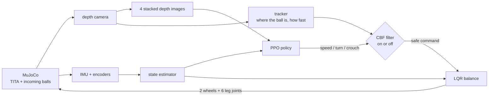

# Mini PAC-MAN

## Pipeline

This loop runs every 0.02 s:



PPO decides how fast to go, whether to turn and whether to crouch. The CBF changes the command a little when a hit is about to happen, and the LQR keeps the robot from falling over.

## Experiments

| | What we want to know | What we compare | Groups |
|---|---|---|---|
| Exp 1 | Should safety be taught during training, or just blocked at runtime? | 3 rewards (only reach the goal / minus points when hit / plus a CBF term) × filter off, on | 6 |
| Exp 2 | TITA needs 0.36 s to speed up. Does it break the filter if the filter ignores that lag? | naive filter vs lag-aware filter | 2 |
| Exp 3 | Is the filter still useful when the ball position isn't accurate? | ball info from the true value / with noise and lag / estimated by the depth camera, plus one group with no filter | 4 |

Every group runs the same 100 seeds. We look at: did it reach the goal, how many balls hit, how close the balls got, and how much the filter stepped in.
Everything has to run on the AMD machine (course rule, CUDA runs don't count).

## Evaluation and videos

The experiment runner is the inference entry point. A quick Exp 3 check is:

```bash
conda activate mini-pacman
python run_mini_pacman_experiments.py \
  --part exp3 \
  --quick \
  --device cuda:0 \
  --out outputs/results/exp3_smoke
```

By default it writes JSONL episode results, `summary.csv`, and PNG plots. Video is opt-in because recording all
100 seeds for every condition would create hundreds of files. Record one or more exact seeds with:

```bash
python run_mini_pacman_experiments.py \
  --part exp3 \
  --quick \
  --device cuda:0 \
  --out outputs/results/exp3_smoke \
  --record-video \
  --video-seeds 10090
```

The MP4 is written to:

```text
outputs/results/exp3_smoke/exp3/videos/exp3_sources_seed10090.mp4
```

The four Exp 3 conditions are shown in a 2x2 comparison. Exp 1 produces one filter-off/on comparison per reward,
and Exp 2 produces one naive/lag-aware comparison. Multiple seeds are allowed:

```bash
--record-video --video-seeds 10041 10090 10095
```

If `--video-seeds` is omitted, only the first evaluation seed (`10000` by default) is recorded. Recording reruns
those selected seeds with the same checkpoint and condition after numeric evaluation; it is not a replay of JSONL,
which does not contain per-frame state. Videos include the green goal marker, goal distance, progress, hits, falls,
and success status. `ffmpeg` must be installed (`sudo apt install ffmpeg` on Ubuntu). `outputs/` is ignored by Git.

Useful commands:

```bash
# all experiments, five seeds per condition, plus videos for one representative seed
python run_mini_pacman_experiments.py --part all --quick \
  --device cuda:0 --out outputs/results/smoke \
  --record-video --video-seeds 10000

# recompute CSV and PNG files only; no inference and no video
python run_mini_pacman_experiments.py --part summary \
  --device cpu --out outputs/results/smoke

# show every available option
python run_mini_pacman_experiments.py --help
```

## Robot: TITA


TITA from Direct Drive Technology (DDT): two legs plus two wheels, 8 joints, 25.7 kg.

Model source: `urdfs/tita_description` in [DDTRobot/ddt_ros2_control](https://github.com/DDTRobot/ddt_ros2_control) (commit `beb05df`). The picture above is our own MuJoCo render.
The model doesn't come with a license, so it's not in this repo. Run `python scripts/download_tita.py` to download it.

## What each file does

The control, training, evaluation, reporting, and selected-seed recording paths are implemented.

```
mini-pacman/
├── train_mini_pacman_policy.py     train PPO, --reward picks which reward (done)
├── run_mini_pacman_experiments.py  run experiments; --part picks one and --record-video records selected seeds
├── minipacman/
│   ├── config.py           every parameter lives here, change numbers here (done)
│   ├── scene.py            builds the MuJoCo scene (TITA + floor + 5 balls) (done)
│   ├── env.py              TITA itself: load the model, set poses, read the state
│   ├── lqr.py              LQR balance, turns commands into motor commands
│   ├── sensors.py          IMU, encoders (with noise)
│   ├── state_estimator.py  guesses the robot state from IMU + encoders
│   ├── balls.py            throwing, bouncing, predicting where a ball goes, did it hit (done)
│   ├── depth_camera.py     depth camera (done)
│   ├── ball_tracker.py     finds and tracks balls in the depth image (done)
│   ├── ball_sources.py     where the ball info comes from (true value / noisy / depth camera) (done)
│   ├── cbf.py              CBF reward term and the safety filter
│   ├── dodge_env.py        the RL environment, wires everything above together
│   ├── vec_env.py          runs many environments at once, plugs into rsl_rl
│   ├── vec_worker.py       the subprocess side of vec_env (no torch, one math thread each)
│   ├── protocol.py         training/evaluation rules: fair Exp 1, evaluation seeds never used to pick anything
│   ├── train_ppo.py        PPO settings and training adapter
│   ├── evaluate.py         runs one experiment group on fixed seeds
│   ├── report.py           statistics, CSV files, and experiment plots
│   ├── runtime.py          logs which GPU we used and whether it's ROCm
│   └── video.py            annotated off-screen comparison videos for selected evaluation seeds
├── scripts/
│   └── download_tita.py    downloads the TITA model
├── tests/                  tests; when you finish a module, remove the skip line in its test file
├── docs/                   pictures for this README, training_protocol.md (how to train and evaluate, read this first)
├── third_party/            the downloaded TITA goes here (not in git)
└── outputs/                training and experiment results (not in git)
```

To see what's done and what's not yet: `python run_mini_pacman_experiments.py --part check`

Before training or evaluating, read [docs/training_protocol.md](docs/training_protocol.md): the code refuses policies
that weren't trained and picked the same way, or were picked on the evaluation seeds.

## Working together: so push / pull don't fight

A few rules:

1. Don't work directly on main. Everyone makes their own branch.
2. Try to only touch the files you're in charge of. Everyone edits `config.py`, so say it in the group chat before you change it.
3. Before you push, pull the latest main into your branch and run `pytest` again. Only push if nothing broke.
4. `third_party/` and `outputs/` don't go into git. Don't force the trained `.pt` files in either (too big).
5. Merge with a PR, and let at least one other person look at it before merging.

First time:

```bash
git clone https://github.com/Hemlock-white/mini-pacman.git
cd mini-pacman
pip install -r requirements.txt
python scripts/download_tita.py
pytest
```

Every time you start working:

```bash
git checkout main
git pull
git checkout -b <branch_name>
```

After finishing a chunk:

```bash
git status                         # which files changed
git diff                           # what changed
git add <file_name>
git commit -m "<what_you_changed>"
```

Before you push:

```bash
git pull origin main               # bring in what others pushed
pytest
git push -u origin <branch_name>
gh pr create --fill                # open a PR, or just click it on the GitHub website
```

When you get a CONFLICT:

```bash
# 1. open the file it names and find the part from <<<<<<< to >>>>>>>
# 2. keep what you want, delete the <<<<<<< ======= >>>>>>> markers
git add <file_name>
git commit
# can't sort it out and want to give up on this merge for now:
git merge --abort
```

After your PR is merged:

```bash
git checkout main
git pull
git branch -d <branch_name>
```
